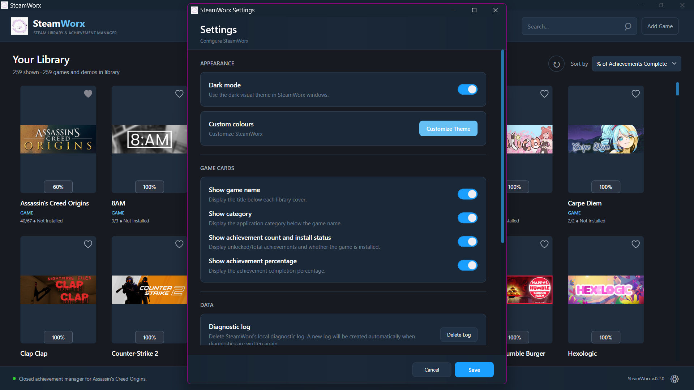
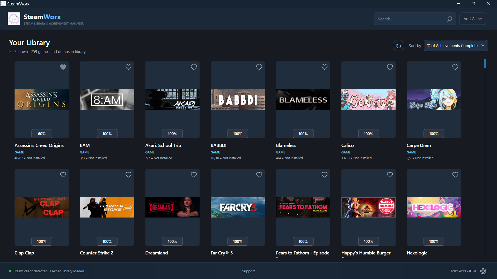
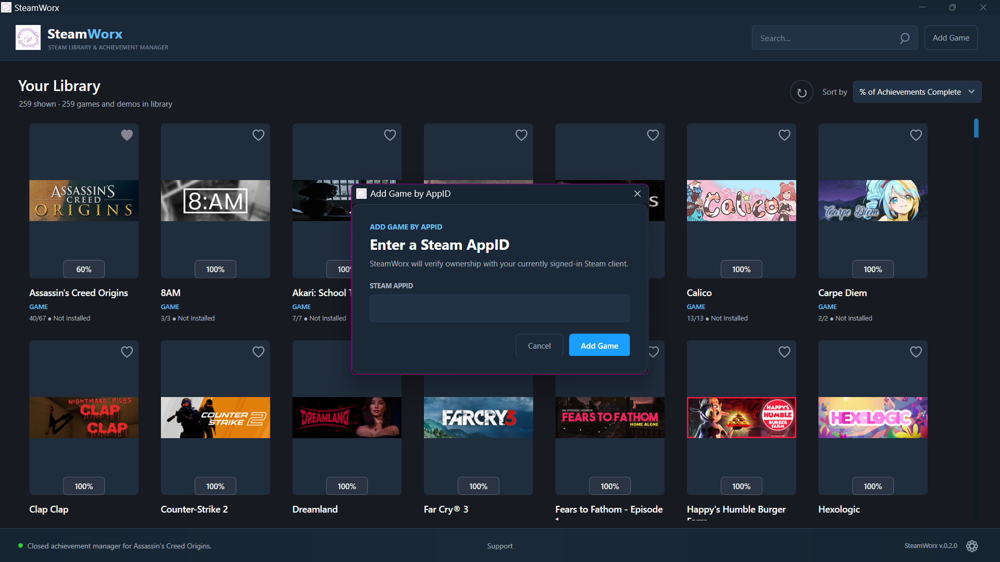
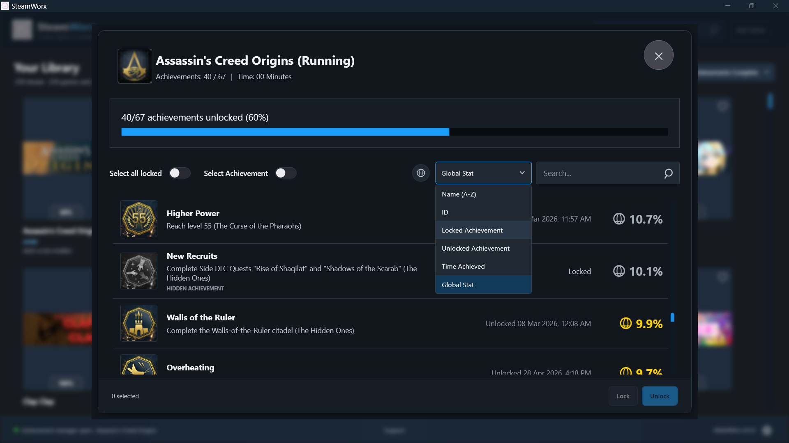

# SteamWorx

 

  
    
  

A custom desktop achievement management and tracking client for Steam inspired by SAM, with customization. SteamWorx connects to the installed Steam client and uses Steam's client APIs together with locally available Steam application data to inspect and manage achievements. It also provides a customizable interface for browsing your game library and achievement progress.

## ⚠️ Important Information
* **Local Operation:** SteamWorx relies on official Steamworks client APIs and local VDF configuration files.
* **Server-Protected Titles:** Titles utilizing publisher server-side authorization will enforce read-only status on client-side state modifications.
* **Requirements:** The official Steam client must be installed, logged in and running in the background.
* **Risks:** Similar to other 3rd party softwares

## Features
* **Modern Interface:** Custom dark theme inspired by Steam's slate navy aesthetic & [UbiSlot](https://github.com/BalTor02/UbiSlot).

  
* **Library Parsing:** Automatic detection of installed Steam games and libraries.

  
* **Manual Game Addition:** Add an owned Steam application by its AppID when it is not automatically listed.

  
* **Achievement Inspection:** Browse achievement names, descriptions, unlock status, unlock dates, and available global achievement statistics.

* **Achievement Management:** Unlock or lock individual achievements through the Steam client interface.

## System Requirements
* Windows 10/11 (64-bit)
* .NET 10 Desktop Runtime
* Running Steam Desktop Client

## Installation

1. Download the latest SteamWorx release from the [Releases](https://github.com/BalTor02/SteamWorx/releases) page.
2. Extract the ZIP file to a location of your choice.
3. Make sure the Steam desktop client is installed, running, and logged in.
4. Run `SteamWorx.exe`.
6. Wait for SteamWorx to detect Steam and populate your game library.

---

## How to use

1. Make sure the Steam desktop client is running and logged in.
2. Launch SteamWorx.exe.
3. Select a game to open its Achievement Manager.
4. Browse the available achievements for the selected game.
5. Toggle **Select Achievement** and then check the box of the achievement you want to modify.
6. Click **Unlock** to unlock the selected achievement.
7. To lock an achievement again, select an unlocked achievement and use the corresponding lock action.
8. Repeat the process for other achievements as required.

---

### Ways to Support

- **⭐ Star this Repository:** Click the **Star** button at the top right of this page.
- **👤 Follow the Profile:** Follow [@BalTor02](https://github.com/BalTor02) for future projects and releases.
- **💖 Sponsor the Work:** Support UbiSlot's development and maintenance through GitHub Sponsors.

  

---

### Bug Reports and Feature Requests

Found a bug or have a feature request? Please open an issue in the repository's Issues section. Include the relevant game/AppID, steps to reproduce the problem, and any relevant diagnostic information.

Standard MIT License
